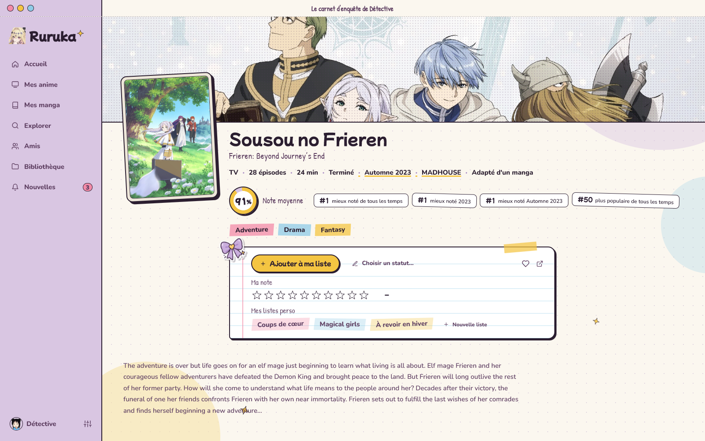
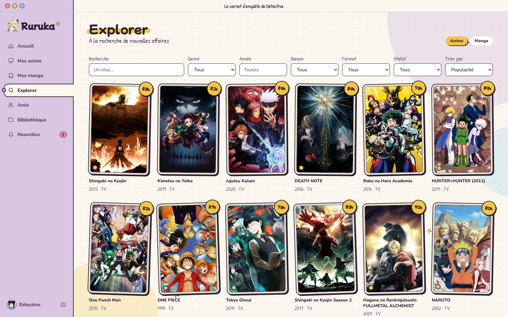
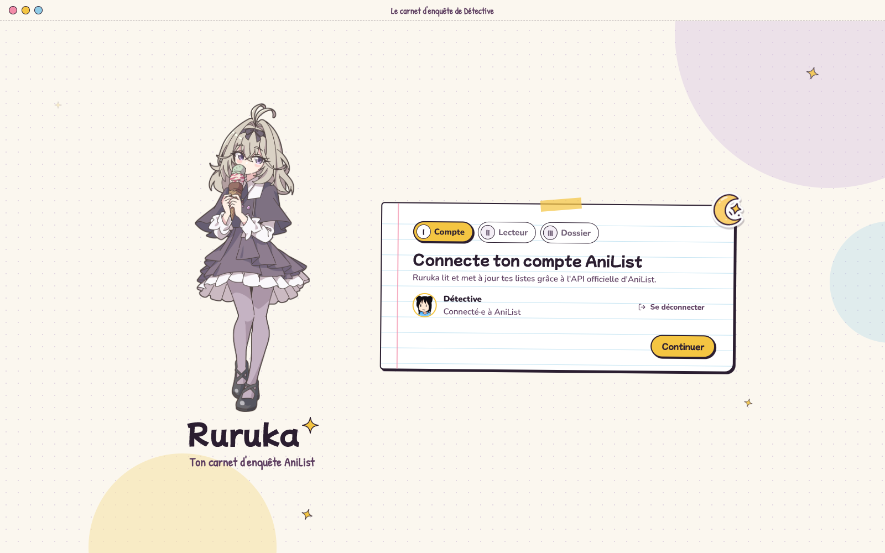

<p align="center">
  
</p>

<p align="center">
  <a href="https://github.com/Mxyuki/Ruruka/releases/latest"><strong>Télécharger Ruruka pour Windows</strong></a>
  &nbsp;·&nbsp;
  <a href="#installer">Installation</a>
  &nbsp;·&nbsp;
  <a href="#premiere-ouverture">Premier lancement</a>
</p>

Ruruka est une petite application Windows pour suivre tes anime et tes manga sur
[AniList](https://anilist.co), habillée comme le carnet d'enquête de Ruruka Moria
(*Meitantei Precure!*). Autocollants, washi tape, étoiles kira : ta liste devient une affaire
à résoudre.

Elle relie aussi ton dossier d'anime à AniList, lance les épisodes dans
[mpv](https://mpv.io) et **coche l'épisode toute seule** quand tu arrives à 85 % (réglable).

<table>
  <tr>
    <td width="50%"></td>
    <td width="50%"></td>
  </tr>
  <tr>
    <td align="center"><em>La fiche d'un anime : note, statut, listes perso</em></td>
    <td align="center"><em>Explorer : les cartes à collectionner de la saison</em></td>
  </tr>
</table>

##  Ce que Ruruka sait faire

- **Ta liste AniList, en plus calme.** Accueil avec l'épisode du jour, tes enquêtes en cours,
  les sorties à venir et ce que regardent tes amis.
- **Ton dossier d'anime relié à AniList.** Chaque sous-dossier est reconnu tout seul (même les
  collections rangées par saison). Si Ruruka se trompe, tu corriges le lien en deux clics.
- **Lecture dans mpv et progression automatique.** Arrivé à 85 % de l'épisode, ta liste se met à jour. Tu peux passer les génériques tant que tu as vraiment vu la moitié de l'épisode ; les deux seuils se règlent.
  Elle ne recule jamais : si tu revois un vieil épisode, ta progression ne bouge pas.
- **Une seule fenêtre mpv pour toute la soirée.** À la fin d'un épisode, mpv reste ouvert ; lance
  le suivant et il s'ouvre dans la même fenêtre, avec le même suivi. Pratique pour regarder entre
  amis en partage d'écran sur Discord.
- **Un petit avertissement** si tu lances l'épisode 20 alors que tu en es au 16. Ruruka te
  propose le 17, mais tu restes libre.
- **Boutons de recherche** sur chaque anime, chaque épisode manquant, chaque notification de
  sortie. Indique ton site de recherche dans **Réglages → Sites** ; sans site, les boutons
  restent cachés.
- **L'épisode tout juste sorti à la une.** Un nouvel épisode annoncé par AniList dans les 12
  dernières heures prend la place de l'affaire du jour.
- **Social** : l'activité de tes amis, les « j'aime », les réponses, et qui te suit en retour.
- **Ta présentation, comme sur AniList.** Spoilers à cliquer, vidéos YouTube intégrées, blocs
  centrés : les profils s'affichent comme sur le site. Le bouton « Modifier » ouvre un éditeur
  avec aperçu en direct et un guide de toutes les balises.
- **Profil en direct.** Entoure un texte de `[watching]…[/watching]` et utilise `${anime}`,
  `${episode}`, `${time}`, `${duration}`… : pendant que tu regardes un épisode, ta présentation
  AniList se met à jour toute seule (toutes les 15 secondes), puis repasse au repos quand tu
  fermes mpv ou Ruruka.
- **La bande-son de chaque anime.** Sur la fiche d'un anime, déroule « La bande-son » : tous
  les openings, endings et chansons (grâce à [AnisongDB](https://anisongdb.com)), à écouter ou
  à regarder en vidéo HQ / MQ sans quitter Ruruka, une fois le serveur des fichiers indiqué dans
  **Réglages → Sites**.
- **Lire tes manga dans Ruruka.** Indique un site de lecture compatible dans **Réglages → Sites** :
  sur la fiche d'un manga, le bouton « Chapitres » liste les chapitres
  dans ta langue, avec chaque équipe de traduction, et les ouvre dans un lecteur page par page
  (clic ou flèches). Arrivé à la dernière page, ta progression AniList (chapitre et tome) se met
  à jour toute seule.
- **Un anime au hasard.** Sur l'accueil, tire au sort ce que tu vas regarder : dans tes anime en
  cours, ta liste « À voir », ou n'importe quel anime populaire que tu n'as pas terminé.
- **Personnes.** Cherche un personnage, un seiyuu ou un membre du staff. La page d'un seiyuu
  montre tous ses personnages, chacun une seule fois, triables par date, favoris ou nom.
- **Ta fiche, dans ton ordre.** Dans les réglages, choisis dans quel ordre s'affichent les
  sections d'un anime ou d'un manga (bouton « Réinitialiser » pour revenir à l'original).
- **Une recherche poussée.** Dans Explorer, combine plusieurs genres et mots-clés, exclus-en
  d'un clic, et règle pour chaque mot-clé son pourcentage minimum. Chaque carte affiche ton
  statut, et le filtre « Ma liste » ne garde que tes anime en cours, résolus, à voir… ou ceux
  que tu n'as pas encore.
- **Les listes des autres.** Depuis un profil, ouvre sa liste d'anime ou de manga, avec les
  mêmes onglets, filtres et tris que la tienne. Dans ta liste, les anime en diffusion passent
  en premier.
- **Carnet de jour ou de nuit.** Thème clair, sombre, qui suit Windows, ou qui change selon
  l'heure (carnet de jour et carnet de nuit aux heures que tu choisis).
- **Listes perso** : ajoute un anime à tes listes personnalisées depuis sa fiche, ou crées-en
  une nouvelle.
- **Discrète** : la croix range Ruruka près de l'horloge, et le suivi de l'épisode continue
  pendant que tu regardes.

<a id="installer"></a>

##  Enquête n°1 : installer Ruruka

1. Va dans les [**Releases**](https://github.com/Mxyuki/Ruruka/releases/latest) et télécharge
   `Ruruka-Setup-x.y.z.exe`.
2. Double-clique dessus, choisis où l'installer, et garde la case « Créer une icône sur le
   bureau ».
3. C'est tout. Ruruka s'ouvre à la fin de l'installation.

Il n'y a rien d'autre à installer : tout est déjà dans le fichier, et WebView2 est fourni avec
Windows 11.

> **Windows affiche « Windows a protégé votre ordinateur » ?**
> C'est normal pour une petite application qui n'a pas de certificat payant. Clique sur
> **Informations complémentaires**, puis sur **Exécuter quand même**.

<a id="premiere-ouverture"></a>

##  Enquête n°2 : la première ouverture



Ruruka te guide en trois étapes.

**I. Ton compte AniList.** AniList demande que chaque application ait son propre identifiant.
Ça prend deux minutes, une seule fois :

1. Ouvre [AniList → Settings → Developer](https://anilist.co/settings/developer) et clique sur
   **Create New Client**.
2. Nom : `Ruruka`. Redirect URL : `https://anilist.co/api/v2/oauth/pin`
3. Copie l'**ID** du client (un nombre), colle-le dans Ruruka et clique sur
   **Se connecter avec AniList**.

**II. Le lecteur vidéo.** Installe [mpv](https://mpv.io/installation/) si tu veux lancer tes
épisodes depuis Ruruka. Il est trouvé tout seul (PATH, Scoop, WinGet, Chocolatey,
Program Files), sinon tu peux indiquer où se trouve `mpv.exe`.

**III. Ton dossier d'anime** (facultatif). Choisis le dossier qui contient tes anime, avec un
sous-dossier par série :

```
D:\Anime\
├── Sousou no Frieren\
│   ├── [SubsPlease] Sousou no Frieren - 01 (1080p).mkv
│   └── [SubsPlease] Sousou no Frieren - 02 (1080p).mkv
└── Mahou Shoujo Lyrical Nanoha Collection\
    ├── Season 1\
    └── Season 2\
```

##  Questions fréquentes

<details>
<summary><strong>Où sont rangées mes données ?</strong></summary>

Uniquement sur ton ordinateur. Les réglages sont dans `%APPDATA%\Ruruka`. Ton jeton AniList y
est chiffré avec Windows (DPAPI) : il ne fonctionne que sur ta session. Ruruka ne parle qu'à
AniList, à AnisongDB pour la bande-son, à GitHub pour les mises à jour, et aux sites que tu as
toi-même indiqués dans **Réglages → Sites** (aucun par défaut).
</details>

<details>
<summary><strong>J'ai fermé Ruruka, mais il tourne encore ?</strong></summary>

Oui : la croix le range dans la zone de notification pour continuer à suivre l'épisode en
cours. Clic droit sur l'icône, puis **Quitter** pour le fermer vraiment. Tu peux changer ce
comportement dans **Réglages**, où tu peux aussi lancer Ruruka au démarrage de Windows : il
s'installe alors discrètement dans la zone de notification.
</details>

<details>
<summary><strong>Comment désinstaller Ruruka ?</strong></summary>

Paramètres Windows → Applications → Ruruka → Désinstaller. Pour tout effacer, supprime
aussi `%APPDATA%\Ruruka` et `%LOCALAPPDATA%\Ruruka`.
</details>

<details>
<summary><strong>L'épisode ne s'est pas coché tout seul.</strong></summary>

Ruruka compte le temps réellement regardé : sauter directement à la fin ne compte pas. Il faut
aussi que l'épisode soit lancé depuis Ruruka (pas en ouvrant le fichier à la main), pour qu'il
sache de quel anime il s'agit.
</details>

##  Pour les développeurs

Il faut le SDK .NET 8 et Node 20 ou plus.

```powershell
cd web; npm install; npm run dev                    # terminal 1
$env:RURUKA_DEV_URL = "http://localhost:5173"
dotnet run --project src/Ruruka.Desktop              # terminal 2 (DevTools activés)

./scripts/build.ps1                                  # build rapide → dist/Ruruka.exe
./scripts/release.ps1                                # installateur → dist/Ruruka-Setup-x.y.z.exe
```

L'app est un hôte C# WinForms + WebView2 avec une interface Svelte 5.
[docs/ARCHITECTURE.md](docs/ARCHITECTURE.md) décrit les couches et où placer chaque
changement.

##  Crédits

Les illustrations de Ruruka utilisées dans l'application et dans ce README viennent de
[cette publication Danbooru](https://danbooru.donmai.us/posts/12428118). Merci à leur auteur·ice !

---

<sub>Projet de fan non officiel, sans lien avec Toei Animation ni AniList. Ruruka Moria et
*Meitantei Precure!* appartiennent à leurs ayants droit. Données fournies par
l'[API AniList](https://anilist.gitbook.io/anilist-apiv2-docs).</sub>
