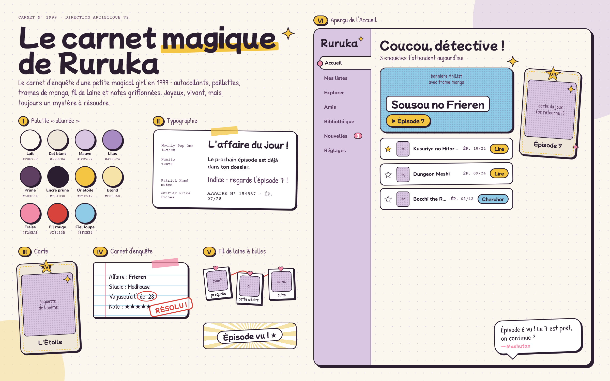

# Ruruka — Concept art v2 « Le carnet magique »

Le carnet d'enquête d'une petite magical girl en 1999 : autocollants, paillettes, trames de
manga, fil de laine et notes griffonnées. Joyeux et vivant, avec toujours un mystère à résoudre.

La source de la planche est [`board.html`](board.html). La première piste, sombre et
« Arcane & Ombre », est gardée pour comparaison :
[`concept-art-v1-sombre.png`](concept-art-v1-sombre.png).

## Ce qui a changé par rapport à la v1

| | v1 « Arcane & Ombre » | v2 « Le carnet magique » |
|---|---|---|
| Ambiance | sombre, élégante, retenue | lumineuse, joyeuse, enfantine |
| Fond | encre `#0E0C10` | lait `#FBF7EF` avec quadrillage de carnet |
| Couleurs | les mêmes teintes, éteintes | les mêmes teintes, allumées, plus fraise et ciel |
| Titres | Cormorant Garamond, serif élégante | Mochiy Pop One, ronde et pop comme un logo de Precure |
| Texte | Instrument Sans | Nunito, ronde et très lisible |
| Notes | Caveat | Patrick Hand, écriture d'écolière |
| Formes | filets dorés fins, coins coupés | contours épais à l'encre prune, ombres décalées d'autocollant, légères rotations |
| Détective | dossier confidentiel, tarot | carnet d'enquête, cartes à collectionner, tampon « RÉSOLU ! » |
| Magie | ombre et projecteur | étincelles kira, trames et lignes de vitesse façon manga |

## Les motifs

1. **Cartes à collectionner.** La carte de tarot devient une carte Precure : coins arrondis, contour
   prune épais, cadre intérieur en pointillés dorés, badge étoile avec son chiffre romain, une
   étincelle. La « carte du jour » se retourne avec un petit rebond.
2. **Carnet d'enquête.** Pages lignées avec marge rose, morceaux de washi tape, mots entourés au
   feutre rouge, tampons « RÉSOLU ! » (anime terminé) et « EN COURS ».
3. **Étincelles et trames manga.** Étoiles kira à quatre branches, trame de points sur les images,
   lignes de vitesse quand il se passe quelque chose (épisode vu, nouvel épisode).
4. **Fil de laine.** Les relations entre œuvres sont des polaroïds reliés par un fil rouge, avec
   des punaises en cœur.
5. **Bulles de Mashutan.** Les notifications sont des bulles de BD signées « — Mashutan ».

Il n'y a toujours pas de dégradé violet-rose ni de glassmorphism. Tout est en aplats pastel,
contours et trames.

---

## Illustrations en place

Les images originales sont dans `Exemple/`. Le script `scripts/prepare-art.ps1` les
redimensionne et les copie dans `web/public/art/` sous leur nom publié. Relance-le après avoir
remplacé une image : `powershell -File scripts/prepare-art.ps1`.

| Source (`Exemple/`) | Publiée (`web/public/art/`) | Où elle apparaît |
|---|---|---|
| `accueil-portrait.png` | `accueil-portrait.png` | Accueil, accoudée sur la bannière de l'enquête du jour |
| `vide.png` | `vide.png` | écrans vides, à côté de la bulle de Mashutan |
| `configuration.png` | `configuration.png` | écran de configuration et page Réglages |
| `dos-de-carte.png` | `dos-de-carte.png` | dos de la « carte du jour » quand elle se retourne |
| `autocollants/Star.png` | `autocollants/etoile.png` | Réglages, premier carnet |
| `autocollants/Loupe.png` | `autocollants/loupe.png` | coin de la bannière de l'Accueil |
| `autocollants/Heart.png` | `autocollants/coeur.png` | carte « agence » de la page Amis |
| `autocollants/Moon.png` | `autocollants/lune.png` | carnet de l'écran de configuration |
| `autocollants/Ribbon.png` | `autocollants/ruban.png` | coin du suivi sur la fiche d'un anime |
| `autocollants/Candy.png` | `autocollants/bonbon.png` | disponible, pas encore posé |

Les autocollants passent par le composant `Sticker.svelte`.

### Icône de l'application

L'icône actuelle (`Exemple/icon.png`, 800 × 800) convient. Si tu en fais une nouvelle :
**1024 × 1024, PNG transparent**, lisible à 16 px. Je régénère le `.ico` avec
`scripts/make-icon.ps1`.

---

## Ce qui ne demande aucune image

- **Jaquettes et bannières d'anime :** elles viennent d'AniList. L'app leur ajoute un contour
  d'autocollant et une trame manga.
- **Cartes, pages de carnet, washi tape, tampons, fil de laine, bulles, étincelles, lignes de
  vitesse :** tout est dessiné en code.

## Palette de référence

| Nom | Hex | Usage |
|---|---|---|
| Lait | `#FBF7EF` | fond du carnet |
| Col blanc | `#EEE7DA` | cartes, papier |
| Mauve | `#D9C6E2` | grands panneaux, barre latérale |
| Lilas | `#A98BC4` | accents, quadrillage |
| Prune | `#5E3F61` | texte secondaire |
| Encre prune | `#2B1E30` | texte principal, contours (jamais de noir pur) |
| Or étoile | `#F4C542` | boutons principaux, étoiles, surlignage |
| Blond | `#F6E3A8` | surlignage doux, lignes de vitesse |
| Fraise | `#F28BA8` | cœurs, nouveautés, badges |
| Fil rouge | `#D8433B` | fil de laine, tampons, erreurs |
| Ciel loupe | `#8FCBE6` | boutons secondaires, lignes du carnet |
